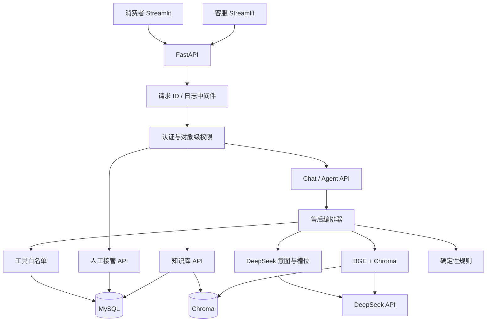
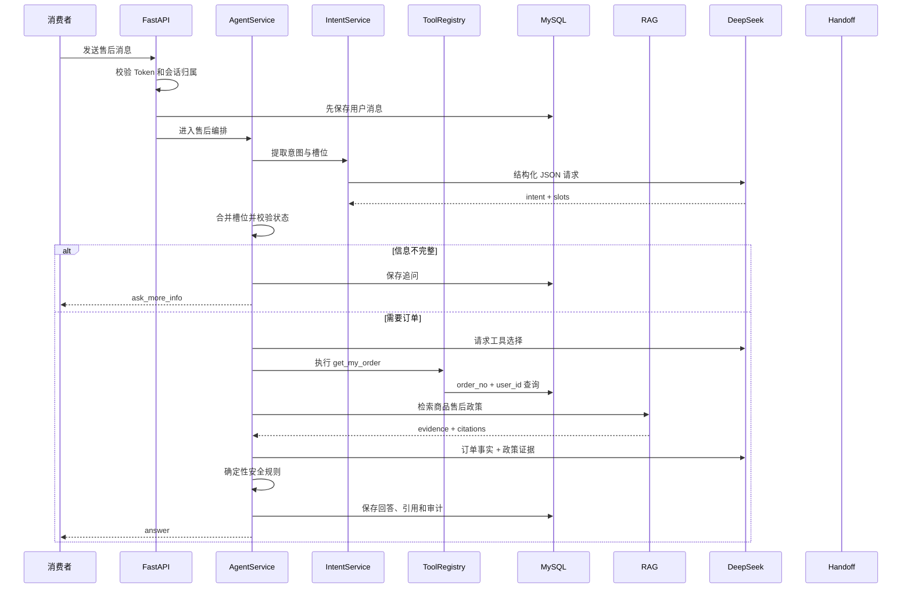
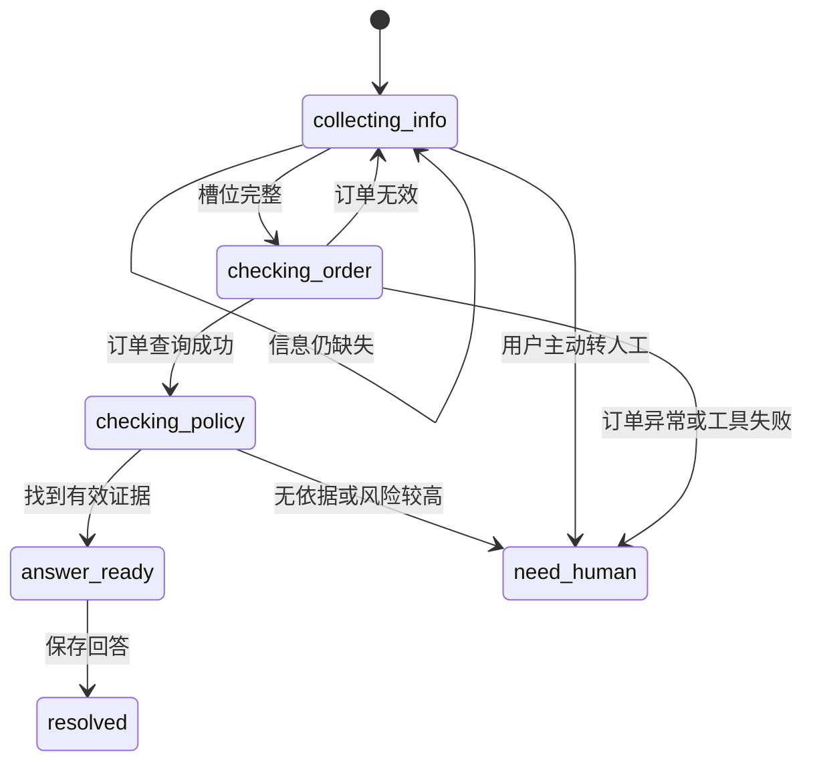
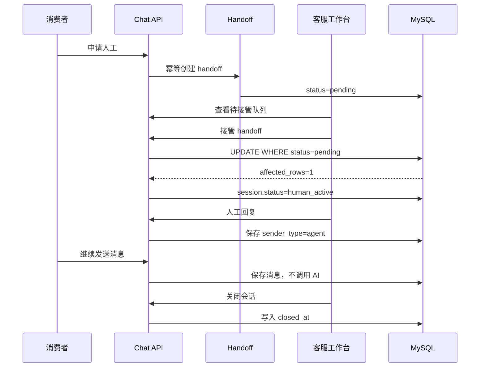
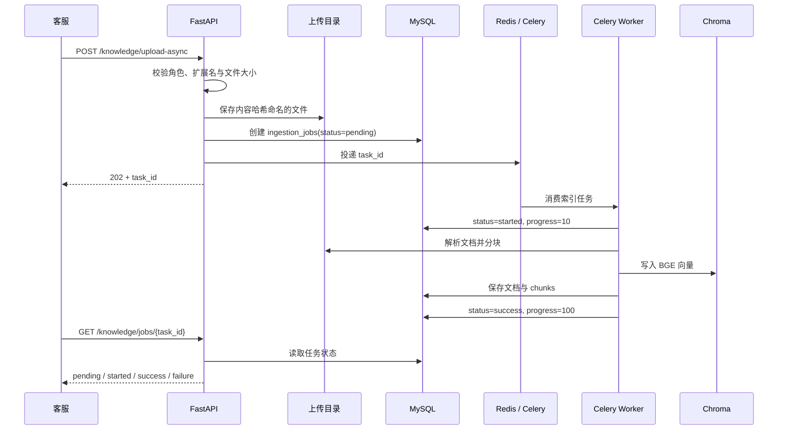

# SmartService AI 架构说明

> 当前定位：单商家售后智能客服的本地可运行技术原型，不是生产部署。
> `开发手册-售后闭环V2.md` 是唯一执行路线；根目录旧手册仅作为历史材料。

## 系统架构

## 售后请求时序

## 任务状态机

`chat_sessions.status` 表示渠道由 AI 还是人工控制；`workflow_state` 表示售后任务阶段，两者不能合并。

## 人工接管时序

## 异步文档索引时序

任务状态以 MySQL `ingestion_jobs` 为准，Redis 只承担任务投递。成功任务重复执行时直接返回原结果；临时数据库错误有限重试，解析或业务错误直接标记失败。

## 文档删除时序

删除接口先按 MySQL 中的 `vector_id` 清理 Chroma，再在同一数据库事务中删除 `documents` 及其级联 `document_chunks`。两次操作之间是短暂一致性窗口；若数据库提交失败，可重新发起删除，向量删除本身是幂等的。

## 数据边界

| 数据 | 唯一可信来源 | 不允许的行为 |
|---|---|---|
| 用户身份 | Bearer Token + `users` | 信任模型或前端传入的 `user_id` |
| 订单事实 | MySQL `orders + products` | 从向量库或模型常识猜测订单状态 |
| 售后政策 | Chroma 检索片段 + 来源文档 | 无证据时编造退款资格 |
| 会话状态 | 后端状态机 | 模型直接写数据库状态 |
| 工具调用 | ToolRegistry + `tool_invocations` | 任意 SQL 或未注册工具 |

## 可观测性

- 每个请求生成 32 位 `X-Request-ID`；
- 请求日志包含方法、路径、状态和总耗时；
- Agent 记录意图、编排、工具、检索和模型耗时；
- 日志不记录 Token、API Key、密码或完整 Prompt；
- 工具审计表记录工具名、脱敏参数、结果摘要、状态和耗时。
